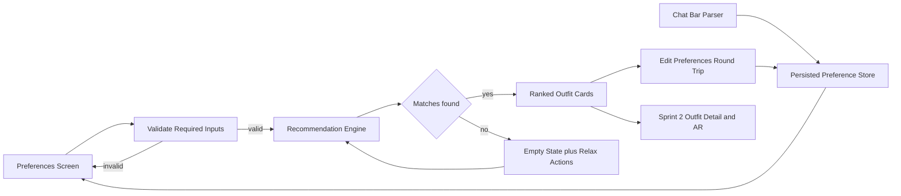
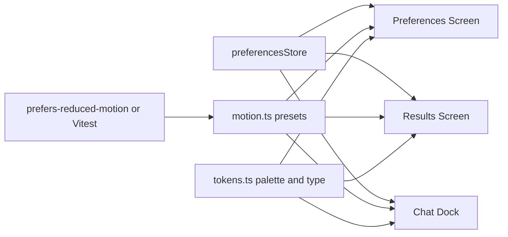
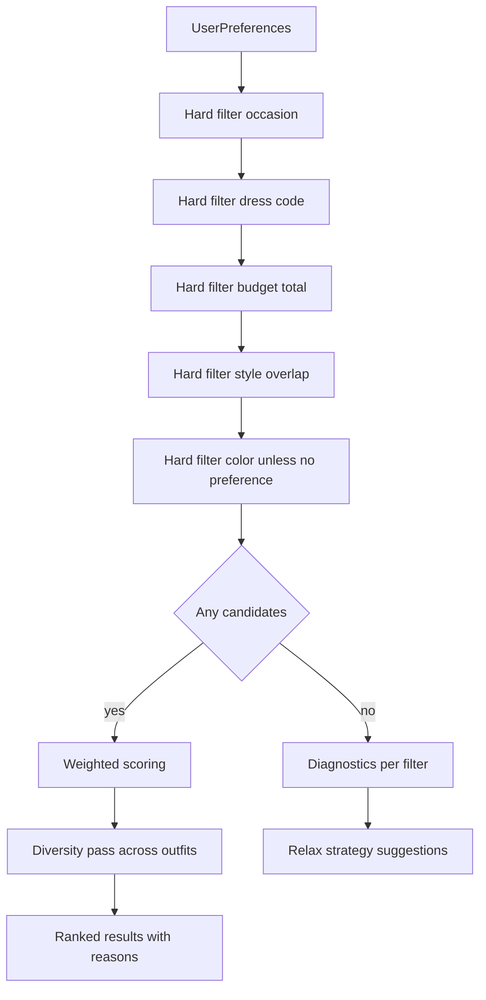

# VibeFit — Sprint 1 Implementation Plan

**Sprint:** VIBE Sprint 1 · 10 Nov – 17 Nov 2026
**Charter milestone:** 11/17/2026 — *Sprint 1: conversational styling assistant and initial outfit recommendations*
**Build target:** MSIS-609 working prototype, final demo 12/08/2026
**Plan status:** approved 11/18/2026 — stack, app path, chat bar, and story ownership all confirmed
**Stack:** Vite + React + TypeScript + Tailwind · React Router · Zustand · Framer Motion · Lucide React
**Visual direction:** Editorial Obsidian & Champagne (see [Design System](#10-design-system--editorial-obsidian--champagne))

---

## 1. What the board actually contains

| Jira Key | Story | Epic | Priority | Points | Assignee | Board Status |
|---|---|---|---|---|---|---|
| VIBE-11 | Select Occasion | User Preferences | 1 | 2 | TC | In Progress |
| VIBE-13 | Select Dress Code | User Preferences | 2 | 1 | TC | In Progress |
| VIBE-14 | Set Outfit Budget | User Preferences | 3 | 2 | LA | To Do |
| VIBE-15 | Choose Style Preferences | User Preferences | 4 | 3 | NN | In Progress |
| VIBE-8 | Generate Outfit Recommendations | AI Outfit Recommendations | 5 | 8 | E | To Do |

**Committed:** 5 items / **16 story points**. The header badge showing `10` does not match the 16-point sum — confirm whether that badge is remaining points, a version label, or a stale count before the Sprint review (it is a reporting discrepancy, not a build blocker).

**Deferred to Sprint 2 (charter 11/24):** View Outfit Details (VIBE-6 equiv.), View Product Prices, Open Shopping Links, Preview Selected Outfit, AR try-on. **Do not build these in Sprint 1** — but the catalog and types must be shaped now so Sprint 2 is additive only.

**Timeline note:** the sprint ended 11/17 and today is 11/18 with 0 items Done. Recommend re-baselining the Sprint 1 end date to 11/19 in Jira and keeping the Sprint 2 start on 11/18, so the 12/08 final presentation is not pushed. Record it as a one-day slip in the team notes.

---

## 2. Acceptance-criteria traceability (the contract for this sprint)

Every line below must be demonstrable and covered by an automated test or a written manual step in [`docs/sprint-1-acceptance-matrix.md`](docs/sprint-1-acceptance-matrix.md).

| AC | Requirement | Implementation home | Verification |
|---|---|---|---|
| **11.1** | View occasion options: Casual Outing, Work, Party, Wedding | [`src/features/preferences/OccasionSelector.tsx`](src/features/preferences/OccasionSelector.tsx) | render test asserts 4 options |
| **11.2** | Select one occasion and continue | same + [`src/features/preferences/validation.ts`](src/features/preferences/validation.ts) | RTL click-through test |
| **11.3** | Clear validation message when occasion missing | [`src/features/preferences/validation.ts`](src/features/preferences/validation.ts) | test asserts message text + `aria-invalid` |
| **11.4** | Occasion retained when recommendations generated | [`src/store/preferencesStore.ts`](src/store/preferencesStore.ts) | persistence test |
| **13.1** | Clearly labeled dress-code options | [`src/features/preferences/DressCodeSelector.tsx`](src/features/preferences/DressCodeSelector.tsx) | 5 options rendered with labels |
| **13.2** | Dress code saved with preferences | store | persistence test |
| **13.3** | Changeable before requesting recommendations | selector on preferences screen | RTL test |
| **13.4** | Recommendations use selected dress code | [`src/engine/recommend.ts`](src/engine/recommend.ts) | engine test per dress code |
| **14.1** | USD numeric budget input | [`src/features/preferences/BudgetInput.tsx`](src/features/preferences/BudgetInput.tsx) | render + input test |
| **14.2** | Reject 0, negative, non-numeric with helpful message | [`src/features/preferences/validation.ts`](src/features/preferences/validation.ts) | table-driven validation test |
| **14.3** | Budget saved on continue | store | persistence test |
| **14.4** | Suggestions respect budget where price is known | engine hard filter | engine test asserts `totalPrice <= budget` |
| **15.1** | Choose at least one style preference | [`src/features/preferences/StyleColorSelector.tsx`](src/features/preferences/StyleColorSelector.tsx) | min-1 validation test |
| **15.2** | Choose colors or "No Color Preference" | same | mutual-exclusivity test |
| **15.3** | Preferences remain visible when returning to edit | store + Edit Preferences round trip | round-trip test |
| **15.4** | Recommendations account for preferences | engine scoring | engine test asserts style/color relevance |
| **8.1** | Request recommendations after required inputs | results route guard | RTL test |
| **8.2** | Suggestions based on occasion, dress code, style, budget | engine | 10-scenario suite |
| **8.3** | Each suggestion identifiable as a distinct outfit | unique `outfit.id` + name on card | distinctness assertion |
| **8.4** | Clear message instead of empty/broken screen | [`src/features/results/EmptyState.tsx`](src/features/results/EmptyState.tsx) | empty-state test |
| **9.1** | Return to preference inputs from results | Edit Preferences action | RTL test |
| **9.2** | Change one preference without clearing others | partial-patch store actions | round-trip test |
| **9.3** | Regenerating updates suggestions | engine re-run on prefs change | test asserts different result set |
| **9.4** | Helpful message when no match | EmptyState | empty-state test |

> Note on cross-cutting AC: VIBE-9 (Refine) is **not** on the Sprint 1 board, but AC 8.4 and the retention requirements of 11.4/13.3/15.3 can only be satisfied by the same state and routing work. We implement the state foundation now so VIBE-9 in Sprint 2 is UI-only. Flag this as a dependency in the Sprint review rather than claiming VIBE-9 done.

---

## 3. Scope guard

**In Sprint 1**

- Project scaffold, routing, design-system tokens, typography, motion primitives, error boundary
- Full "Editorial Obsidian & Champagne" visual layer: glassmorphic surfaces, ambient mesh glows, serif/Sans/Mono type scale, Framer Motion page transitions and staggered reveals
- Domain types + Zod schemas + full seed catalog (data only; no price/link UI)
- Persisted preference store (survives navigation and refresh)
- The four preference inputs with validation
- Recommendation engine with hard filters, scoring, reasons, empty state + relax actions
- Results screen with distinct outfit cards and an Edit Preferences round trip
- Conversational chat bar with a **deterministic local parser** (charter names this as a Sprint 1 deliverable)
- Vitest suite incl. the 10 charter test scenarios
- Acceptance matrix doc + 5-minute demo script

**Explicitly out of Sprint 1**

- Itemised price display, "$XX.XX" formatting, Total Outfit Price, "Sample Price — Retrieved [Date]" badge (Story 7 / Sprint 2)
- "Shop at [Retailer]" buttons (Story 8 / Sprint 2)
- Outfit Detail view, combined-look canvas, AR camera try-on (Sprint 2)
- Live scraping, any external AI API call, payment, auth

**Scope tension to be aware of:** Story 3 AC4 and Story 5 AC2 require the engine to respect *budget*, which requires prices in the catalog. So `catalog.json` carries real price values in Sprint 1 and the engine filters on them — we simply do not render itemised price UI until Sprint 2. Budget compliance is surfaced on the card as a short "Fits your $X budget" indicator, which is recommendation feedback, not the Story 7 price display.

---

## 4. Open decisions

| # | Decision | Resolution | Consequence for this sprint |
|---|---|---|---|
| D1 | Vite + React Router vs Next.js App Router | **Vite + React Router** — resolved | SPA only; `getUserMedia` and localStorage persistence stay simple; single static build target for Sprint 2 AR |
| D2 | App location | **`app/` subfolder** — resolved | Docs and link audits live in `docs/`; backlog XLSX, charter PDF, and `plans/` stay outside the build root |
| D3 | Chat bar in Sprint 1? | **Yes — deterministic parser only** — resolved | Satisfies the charter's 11/17 conversational-assistant milestone with no API key, no cost, no demo failure mode |
| D4 | Ownership of VIBE-11 / VIBE-13 / VIBE-15 | **Implement fully in this repo** — resolved | Teammates review their story's section against the acceptance matrix rather than merging separate code. One repo, one implementation. |
| D5 | Where prices come from | Curated `catalog.json` with `priceRetrievedAt` | Charter risk register requires "display when information was retrieved"; fits the $40 extraction budget line |
| D6 | Recommendation "AI" | Deterministic hybrid: filter + weighted score + reason strings | Satisfies the testable 8/10 scenario criterion; optional LLM re-ranking later behind the same interface |

---

## 5. Architecture



**Render layer.** Every screen is wrapped by a `PageTransition` Framer Motion boundary. Preference inputs, result cards, and chat replies all compose from one shared motion vocabulary defined once in [`src/lib/motion.ts`](src/lib/motion.ts), so the animation feel is consistent and the durations are adjustable from a single file (which is what makes the reduced-motion and test overrides a one-line change).



**Engine pipeline**



**State model.** One Zustand store with `persist` (localStorage key `vibefit:sprint1:v1`) holding `preferences`, `fieldErrors`, `results`, `lastGeneratedAt`, and `chatLog`. All mutations are **partial patches** (`setPreference('dressCode', x)`), which is what mechanically guarantees VIBE-13 AC3 and Story 9 AC2. No screen owns local preference state — otherwise the "don't clear other selections" AC breaks on remount.

---

## 6. Domain model and catalog

Types live in [`src/types/domain.ts`](src/types/domain.ts), validated by Zod at load time so a bad catalog row fails loudly in dev.

```ts
type Occasion   = 'Casual Outing' | 'Work' | 'Party' | 'Wedding';
type DressCode  = 'Casual' | 'Smart Casual' | 'Business Formal' | 'Cocktail' | 'Black Tie';
type StylePref  = 'Minimalist' | 'Classic' | 'Trendy' | 'Streetwear' | 'Bohemian';
type ColorPref  = 'Black' | 'White' | 'Navy' | 'Beige' | 'Earth Tones' | 'Colorful' | 'No Color Preference';
type Slot       = 'top' | 'layer' | 'bottom' | 'shoes' | 'accessory';

interface Product {
  id: string; name: string; retailer: string; slot: Slot;
  price: number | null;                 // null = "Price Unavailable" in Sprint 2
  productUrl: string | null;            // null = no shop link in Sprint 2
  priceRetrievedAt: string | null;
  colors: string[]; styles: StylePref[];
  image: string;
  arSupported: boolean; overlayAsset: string | null;
}

interface Outfit {
  id: string; name: string;
  occasions: Occasion[]; dressCodes: DressCode[];
  styles: StylePref[]; colors: string[];
  itemIds: string[]; heroImage: string;
}
```

**Catalog seed requirements** (`src/data/catalog.json`)

- 20 products; ≥5 tops/jackets flagged `arSupported: true` with `overlayAsset` paths reserved (PNGs land in Sprint 2)
- 12 pre-assembled outfits; every `Occasion × DressCode` reachable; coverage from $80 to $500+
- Each outfit is complete: top + bottom + shoes (+ layer where applicable)
- Edge cases required for Sprint 2 demo: exactly one product with `price: null` and one with `productUrl: null`
- ≥90% of `productUrl` values must be verified working retailer pages — log each check in [`docs/product-link-audit.md`](docs/product-link-audit.md) during catalog creation, since this is a charter success criterion (90% correct links)
- Every outfit used by a test scenario must be explainable: its `occasions`/`dressCodes` are what the reason string cites

---

## 7. Recommendation engine spec

Entry point: `recommendOutfits(prefs, catalog, { limit = 6 })` in [`src/engine/recommend.ts`](src/engine/recommend.ts) → `{ outfits: RankedOutfit[]; diagnostics: { occasion: number; dressCode: number; budget: number; style: number; color: number } }`.

**Hard filters, in order, each retaining a count for diagnostics**

1. `outfit.occasions.includes(occasion)`
2. `outfit.dressCodes.includes(dressCode)`
3. `knownTotal <= budget` — items with `price: null` are excluded from the sum and the outfit is marked `priceComplete: false` (AC 14.4 "where price information is available")
4. at least one style overlap
5. if color ≠ `No Color Preference`, at least one color overlap

**Scoring (deterministic, no randomness)**

| Signal | Points |
|---|---|
| Occasion exact | +30 |
| Dress code exact | +20 |
| Style overlap | +10 each, cap 30 |
| Color overlap | +8 each, cap 16 |
| Budget headroom (total ≤ 70% of budget) | +15 |
| Complete price data | +5 |

Sort by score descending; tie-break on a stable hash of `outfit.id` so results never reshuffle between renders. `limit` selections pass through a diversity filter (no two results may share the same `top` product) so cards look genuinely distinct (AC 8.3).

**Reasons** — each result carries 1–3 short strings rendered on the card, e.g. "Matches Work", "Business Formal", "$186 of your $250 budget". These double as demo narration and as test assertions.

**Empty state + relax** ([`src/engine/relax.ts`](src/engine/relax.ts)): when results are empty, compute up to three concrete alternatives with live counts, ordered by cheapest change:

1. Raise budget to the cheapest matching outfit total
2. Ignore color preference
3. Shift dress code to the adjacent formality level

Each renders as a button stating the exact outcome ("Show 2 outfits with your budget raised to $310"), satisfying AC 8.4 and Story 9 AC4 without a dead end.

---

## 8. Validation rules

| Field | Accepts | Rejects with message |
|---|---|---|
| Occasion | one of 4 | "Pick an occasion so we can style for the right event." |
| Dress code | one of 5 | "Choose a dress code — it sets the formality of your outfits." |
| Styles | ≥1 of 5 | "Choose at least one style you like." |
| Colors | ≥1 of 7, with `No Color Preference` mutually exclusive with concrete colors | "Pick a color, or choose No Color Preference." |
| Budget | digits with optional `$` and thousands separators, > 0, ≤ 100,000 | empty → "Enter your clothing budget in US dollars." · non-numeric → "Use numbers only, like 250." · zero → "Budget must be greater than $0." · negative → "Budget can't be negative." · huge → "That's higher than expected — try a value under $100,000." |

Inputs use `inputMode="decimal"`, `aria-invalid`, `aria-describedby`, and `role="alert"` on messages; errors appear on blur and on submit attempt, never while the user is mid-typing the first character.

---

## 9. Conversational mode (D3)

[`src/features/chat/parseIntent.ts`](src/features/chat/parseIntent.ts) — pure function, no network:

```ts
parseChatMessage(text: string, current: UserPreferences):
  { patch: Partial<UserPreferences>; reply: string; understood: boolean; appliedFields: string[] }
```

- Occasion: wedding / party / work / office / casual / weekend / date
- Dress code: black tie, cocktail, business formal, smart casual, casual
- Budget: `$250`, `under 250`, `250 dollars`, `max 300`, `budget of 180`
- Style: minimalist / classic / trendy / streetwear / bohemian
- Color: black / white / navy / beige / earth tones / neutral / colorful
- Follow-up "cheaper" / "less expensive" → `budget = knownTotal × 0.8` of the current best result
- Unrecognised input → no patch, return a clarifying reply listing what it can change and prompting for the missing field (mirrors the charter risk mitigation "ask clarifying questions when details are missing")

The bar renders above the preference sections so a single sentence can populate all four states, then shows a transcript line confirming exactly which fields changed — that confirmation is what makes the "chat updates preferences" claim demonstrable rather than hidden magic.

---

## 10. Design System — Editorial Obsidian & Champagne

Target feel: SSENSE / Farfetch editorial restraint crossed with the command-surface precision of Linear and Raycast. Dark-first, low-noise, high-contrast type, motion used for confirmation rather than decoration.

### 10.1 Dependencies added at scaffold time

`framer-motion`, `lucide-react`, `clsx`, `tailwind-merge` (plus the existing Zustand, React Router, Zod, Vitest stack). `clsx` + `tailwind-merge` power a single [`cn()`](app/src/lib/cn.ts) helper so conditional variant classes never collide.

### 10.2 Tokens — single source of truth in [`src/styles/tokens.ts`](app/src/styles/tokens.ts)

| Token group | Values |
|---|---|
| Canvas | `--obsidian: #09090B` base background; page never uses pure black |
| Ambient glow | `rgba(212, 175, 55, 0.08)` champagne mesh · `rgba(139, 92, 246, 0.07)` violet mesh, as two large blurred radial gradients fixed behind content |
| Surfaces | `bg-white/[0.03]` + `backdrop-blur-xl` + `border border-white/10`; elevated variant `bg-white/[0.05]` |
| Champagne gold | `#E5C158` — primary actions, selected states, active borders, match-ring stroke |
| Electric violet | `#A855F7` — AI assistant badge, sparkle glyphs, chat dock focus glow |
| Semantic | Emerald `#34D399` budget comfortable · Amber `#FBBF24` budget tight · Rose `#FB7185` over/mismatch |
| Text | `#FAFAFA` primary · `#A1A1AA` secondary · `#71717A` tertiary |
| Radii | surfaces `1rem`, tiles `0.875rem`, pills `999px` |
| Elevation | glass ring + `shadow-[0_1px_0_rgba(255,255,255,0.06)_inset]`; no heavy drop shadows |

Contrast note: gold `#E5C158` on obsidian exceeds 7:1 for text but is reserved for fills and borders with `#09090B` text on gold — never gold text on glass below 16px, where `#FAFAFA` is used instead.

### 10.3 Typography — loaded in [`app/index.html`](app/index.html)

| Role | Family | Usage |
|---|---|---|
| Editorial display | **Instrument Serif** with **Cormorant Garamond** fallback | Page titles, outfit names, section headers, the wordmark |
| UI sans | **Plus Jakarta Sans** | Labels, buttons, chips, body copy, validation messages |
| Data mono | **JetBrains Mono** | USD amounts, budget meter values, match percentages, scenario IDs |

Loaded via `preconnect` + a single `display=swap` stylesheet request. `font-display: swap` matters here: the demo must render readable text on first paint of a cold network.

Type scale: `display 56/48/40`, `heading 28/24`, `label 13 uppercase tracking-[0.08em]`, `body 15`, `mono 13`. Italic Instrument Serif is used deliberately for the empty-state message to make it feel authored rather than like an error.

### 10.4 Component inventory (built in Sprint 1, extended in Sprint 2)

| Component | Spec |
|---|---|
[`Surface.tsx`](app/src/components/ui/Surface.tsx) | Glass panel primitive — the base for every card, dock, and modal |
[`Pill.tsx`](app/src/components/ui/Pill.tsx) | Magnetic-feel selectable tag; Framer `layoutId` shared border + checkmark |
[`BentoTile.tsx`](app/src/components/ui/BentoTile.tsx) | Editorial card wrapper with optional `layoutId` selection ring |
[`MatchRing.tsx`](app/src/components/ui/MatchRing.tsx) | SVG ring, score as mono percentage, animated stroke on mount only |
[`BudgetMeter.tsx`](app/src/components/ui/BudgetMeter.tsx) | `$Total / $Budget` bar with semantic color and mono labels |
[`ChatDock.tsx`](app/src/features/chat/ChatDock.tsx) | Floating glassmorphic command bar |
[`FieldError.tsx`](app/src/components/ui/FieldError.tsx) | `role="alert"` message with rose accent and shake trigger |
[`PageTransition.tsx`](app/src/components/ui/PageTransition.tsx) | Route-level fade/slide wrapper |

### 10.5 Per-story visual treatment

**VIBE-11 Occasion (tiles).** Four large bento cards in a 2×2 grid, each with a Lucide glyph, the occasion name in Instrument Serif, and a one-line editorial descriptor. Selection animates a champagne ring in via `layoutId="occasion-ring"` so the ring physically travels between cards instead of blinking.

**VIBE-13 Dress Code (ladder).** Present the five options on an explicit formality ladder from Casual to Black Tie, with a thin gold progress rail behind the row. This is a design improvement over radio buttons *and* it makes AC 13.3 obvious: changing dress code visibly slides a single indicator along the rail.

**VIBE-14 Budget (input + tier bar + shake).** The strict numeric input from §8 is primary and fully accessible. Beside it sits a live non-authoritative tier meter — Under $100 / $100–200 / $200–350 / $350+ — rendered in JetBrains Mono with a gold fill. The slider is an *optional accelerator* that only writes the same sanitized value into the same store field, so it can never bypass AC 14.2. Invalid submissions trigger a 3-frame horizontal shake on the field wrapper plus the `role="alert"` text; the shake is decorative and carries no information not already in the text.

**VIBE-15 Style & Color (pills + swatches).** Styles are magnetic pills. Colors are real swatches with a small champagne checkmark, and `No Color Preference` is a visually distinct full-width pill with a Lucide `CircleSlash` glyph. Because AC 15.2 requires mutual exclusivity, selecting a concrete color deselects `No Color Preference` in the same patch, and the store enforces it independently of the UI.

**Chat Dock.** Fixed glass dock with an animated conic-gradient border that activates only on `:focus-within`. Above it, three suggestion chips ("Summer wedding under $250", "Make it cheaper", "Business formal for work"). After parsing, a row of small pill-patches animates in showing exactly the fields that changed (`Occasion → Wedding`, `Budget → $250`) with champagne dots — this socialises the parser's behaviour, which is the difference between a demo that looks clever and one that looks trustworthy.

**Results (bento grid).** Staggered fade-up at `staggerChildren: 0.08`, `y: 12 → 0`. Each card: hero garment image with slow hover zoom, outfit name in Instrument Serif, `MatchRing` in the corner, `BudgetMeter` across the bottom, reason strings as subtle mono chips, and a glowing `AR Ready` badge (violet, `Sparkles` icon) when the outfit contains one of the five AR-supported tops/jackets. The AR badge is data-driven off `arSupported`, and in Sprint 1 it advertises Sprint 2 capability — so it must be worded as readiness ("AR Ready"), never as an available feature, to avoid overstating prototype scope in the sponsor demo.

**Empty state.** Italic serif headline, a calm one-sentence explanation, then the three relax buttons rendered as bento tiles each showing its resulting count. No red, no alarm icon — a constraint conflict is a styling problem, not an error.

### 10.6 Motion vocabulary in [`src/lib/motion.ts`](app/src/lib/motion.ts)

| Preset | Value |
|---|---|
| `pageTransition` | opacity 0→1, y 8→0, 240ms, ease `[0.22, 1, 0.36, 1]` |
| `staggerContainer` | `staggerChildren: 0.08`, `delayChildren: 0.04` |
| `cardReveal` | opacity 0→1, y 12→0, 320ms |
| `dockFocusGlow` | conic gradient rotation, 6s linear infinite, focus only |
| `shake` | x `[0, -6, 6, -3, 0]`, 220ms |
| `patchPop` | scale 0.9→1, opacity 0→1, 180ms |

### 10.7 Accessibility and testability guardrail (hard requirement)

Framer Motion is a presentational layer only — it must never own behaviour.

1. **Semantic elements only.** Motion variants wrap `motion.button`, `motion.div`, `motion.li`. Real `<button>`, `<input>`, `<label>`, `<fieldset>`, and `role="alert"` are preserved. Selection state is expressed through `aria-pressed` / `aria-checked` / `aria-invalid` first, with `layoutId` purely decorative.
2. **Reduced motion.** A single `useReducedMotion()`-backed `motionSafe` object collapses all presets to `{ duration: 0 }` when `prefers-reduced-motion: reduce` is set. Zero information is conveyed by animation alone.
3. **Test environment override.** [`src/lib/motion.ts`](app/src/lib/motion.ts) exports `MOTION_DISABLED` triggered by `import.meta.env.MODE === 'test'` or `import.meta.env.VITEST`, so every animation resolves instantly in Vitest. No `await sleep()` or `waitFor` on animation frames anywhere in the suite; tests assert DOM state, not animation state.
4. **No layout-dependent assertions.** Staggered reveals must not gate mount. Cards exist in the DOM on first render; only their opacity/transform animate. This keeps `getByRole` queries reliable and keeps the "distinct outfits" assertions from depending on timing.
5. **Contrast and focus.** Champagne focus ring `ring-2 ring-[#E5C158]/60 ring-offset-2 ring-offset-[#09090B]` on every interactive element; keyboard order follows visual order; the chat dock is reachable by `Tab` and dismissible by `Escape`.
6. **Performance.** Ambient glows are static CSS gradients, not animated canvases. Only `transform` and `opacity` animate. Hover zoom uses `scale` on the image inside an `overflow-hidden` frame.

---

## 11. Repository layout

```
VibeFit/
├── app/
│   ├── index.html
│   ├── package.json · vite.config.ts · vitest.config.ts · tailwind.config.ts
│   └── src/
│       ├── main.tsx · App.tsx · routes.tsx · index.css
│       ├── styles/tokens.ts · theme.css
│       ├── lib/cn.ts · motion.ts · format.ts
│       ├── types/domain.ts
│       ├── data/catalog.json · catalog.schema.ts · testScenarios.ts
│       ├── store/preferencesStore.ts
│       ├── engine/recommend.ts · score.ts · relax.ts · __tests__/
│       ├── features/
│       │   ├── preferences/  PreferencesPage.tsx · OccasionSelector.tsx · DressCodeSelector.tsx
│       │   │                 BudgetInput.tsx · BudgetTierBar.tsx · StyleColorSelector.tsx · validation.ts
│       │   ├── chat/         ChatDock.tsx · parseIntent.ts · SuggestionChips.tsx · PatchFeedback.tsx
│       │   └── results/      ResultsPage.tsx · OutfitCard.tsx · EmptyState.tsx · RelaxTile.tsx
│       └── components/
│           ├── ui/       Surface · Pill · BentoTile · MatchRing · BudgetMeter · FieldError
│           │             PageTransition · StepIndicator · ErrorBoundary
│           └── layout/   AppShell.tsx · AmbientBackground.tsx · Header.tsx
├── docs/sprint-1-acceptance-matrix.md · demo-script.md · product-link-audit.md · design-tokens.md
└── plans/sprint-1-plan.md
```

Tailwind theme extends `colors.editorial` (obsidian, champagne, violet, semantic), `fontFamily.display/sans/mono`, and `backgroundImage.meshChampagne` / `meshViolet` from the same token source, so a palette change is a one-file edit rather than a grep across components.

Routes: `/preferences` (default) → `/results`, with a guard that redirects to `/preferences` when required inputs are missing, so a hard refresh never lands on a broken results page.

---

## 12. Test plan

Vitest + Testing Library + jsdom. Scripts: `npm test`, `npm run test:coverage`, `npm run typecheck`, `npm run build`.

**Charter 10 scenarios** in [`src/data/testScenarios.ts`](src/data/testScenarios.ts) — the suite asserts the charter's "8 of 10" bar explicitly and reports the pass count.

| # | Occasion | Dress code | Budget | Styles | Colors | Expected |
|---|---|---|---|---|---|---|
| 1 | Casual Outing | Casual | $120 | Minimalist | Beige | ≥2 outfits, all ≤ $120 |
| 2 | Work | Business Formal | $400 | Classic | Navy | ≥2 outfits |
| 3 | Party | Cocktail | $250 | Trendy | Black | ≥2 outfits |
| 4 | Wedding | Black Tie | $500 | Classic | Black | ≥2 outfits |
| 5 | Work | Business Formal | $80 | Streetwear | Colorful | **empty state + relax actions** |
| 6 | Wedding | Cocktail | $250 | Bohemian | No Color Preference | ≥2 outfits |
| 7 | Casual Outing | Smart Casual | $150 | Streetwear | No Color Preference | ≥2 outfits |
| 8 | Party | Casual | $200 | Bohemian | Earth Tones | ≥1 outfit |
| 9 | Work | Smart Casual | $300 | Minimalist | Beige | ≥3 outfits |
| 10 | Casual Outing | Casual | $90 | Trendy | White | ≥1 outfit |

Each assertion checks: unique ids, complete item sets, total ≤ budget, non-empty reasons. Scenario 5 is the deliberate negative case for AC 8.4 / 9.4.

**Additional suites:** budget validation table (~12 cases), style/color mutual exclusivity, persistence across simulated refresh, Edit Preferences round trip preserving untouched fields, chat parser (~15 utterances incl. "Show me a cheaper option"), and a guard test that no product with `price: null` is counted into a budget total.

**Design-layer suites** (kept deliberately small so the visual layer cannot become a testing tax):

1. `motion.test.ts` — asserts `MOTION_DISABLED` is true under Vitest and that each preset collapses to zero duration, so no future refactor silently reintroduces animation-dependent flakiness.
2. `a11y.test.tsx` — every selectable control exposes `aria-pressed` or `aria-checked`; every invalid field exposes `aria-invalid` and an `aria-describedby` pointing at an existing `role="alert"` node; the chat dock is keyboard reachable and `Escape`-dismissible.
3. `tokens.test.ts` — contrast guard for the semantic combinations actually used (gold fill on obsidian, rose on glass, white on glass) so no one ships an unreadable badge.
4. Snapshot-free assertion style throughout: no snapshot tests on animated components.

---

## 13. Risks for this sprint

| Risk | Impact | Mitigation |
|---|---|---|
| Sprint end date passed with 0 items Done | Spin look poor at review | Re-baseline Sprint 1 to 11/19, log the slip, keep Sprint 2 start fixed |
| Three stories already "In Progress" with no code in the repo | Duplicate or conflicting work | Confirm ownership (D4) before scaffolding; one repo, one branch strategy |
| 16 points of committed scope plus a charter-mandated chat bar | Sprint overrun | Chat bar is a thin deterministic parser, not an LLM integration; if time is short, ship it read-only against the preference form |
| Catalog link validity at 90% | Charter success criterion | Audit links during catalog creation, record in [`docs/product-link-audit.md`](docs/product-link-audit.md) |
| Price drift in sample data | Demo credibility | Store `priceRetrievedAt`; Sprint 2 surfaces the "Sample Price" badge |
| Empty-state reachable too easily in demo | Looks broken to sponsor | Scenario 5 is the only intentional empty case; relax buttons always produce a path forward |
| Motion layer drifts into owning behaviour | Flaky tests, broken ACs | Semantic elements plus `aria-*` state asserted by `a11y.test.tsx`; all animation gated behind `motionSafe` |
| Web fonts fail or load slowly on demo network | Jarring first paint | `display=swap` with a serif fallback stack; layout stable because sizes come from scale tokens, not glyph metrics |
| Contrast fails on glass at small sizes | Accessibility and rubric risk | `tokens.test.ts` guards shipped combinations; gold is fill-only, never small gold body text |
| Glass and blur overuse janks the demo device | Stutter during card stagger | Ambient glows are static CSS; only `transform`/`opacity` animate; blur limited to a few large surfaces |
| Design polish consumes sprint capacity | Committed stories miss 11/19 | Visual work is scheduled inside each story's own step, not as a separate phase; the chat dock and result cards degrade to plain glass panels if time runs out |

---

## 14. Definition of Done for Sprint 1

1. All 20 Sprint 1 acceptance criteria have a passing test or a documented manual verification step in the acceptance matrix.
2. `npm run typecheck && npm test && npm run build` pass clean.
3. All four preferences survive a page refresh and an Edit Preferences round trip.
4. The 10 scenario suite reports ≥8/10 meeting occasion, dress code, and budget.
5. Empty state and its relax buttons are reachable and demonstrate a recovery path.
6. Chat bar updates all four preference states from one sentence and confirms what it changed.
7. 5-minute demo script runs end-to-end with no console errors.
8. Design system is in place and consistent: palette, type roles, glass surfaces, and motion presets all resolve from [`tokens.ts`](app/src/styles/tokens.ts) and [`motion.ts`](app/src/lib/motion.ts), with no hardcoded hex values in feature components.
9. `motion.test.ts` and `a11y.test.tsx` pass, and reduced-motion mode is manually verified, proving animation never owns behaviour.
10. Jira: VIBE-11, VIBE-13, VIBE-14, VIBE-15, VIBE-8 transitioned to Done with a link to the acceptance matrix, plus the Sprint 1 date re-baseline note attached.
