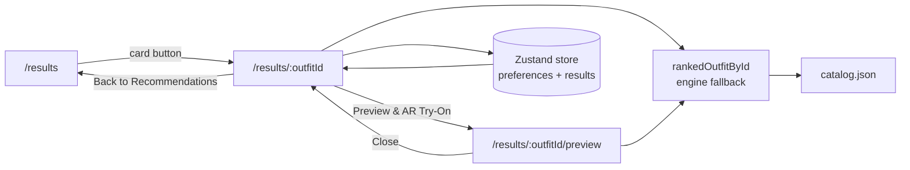
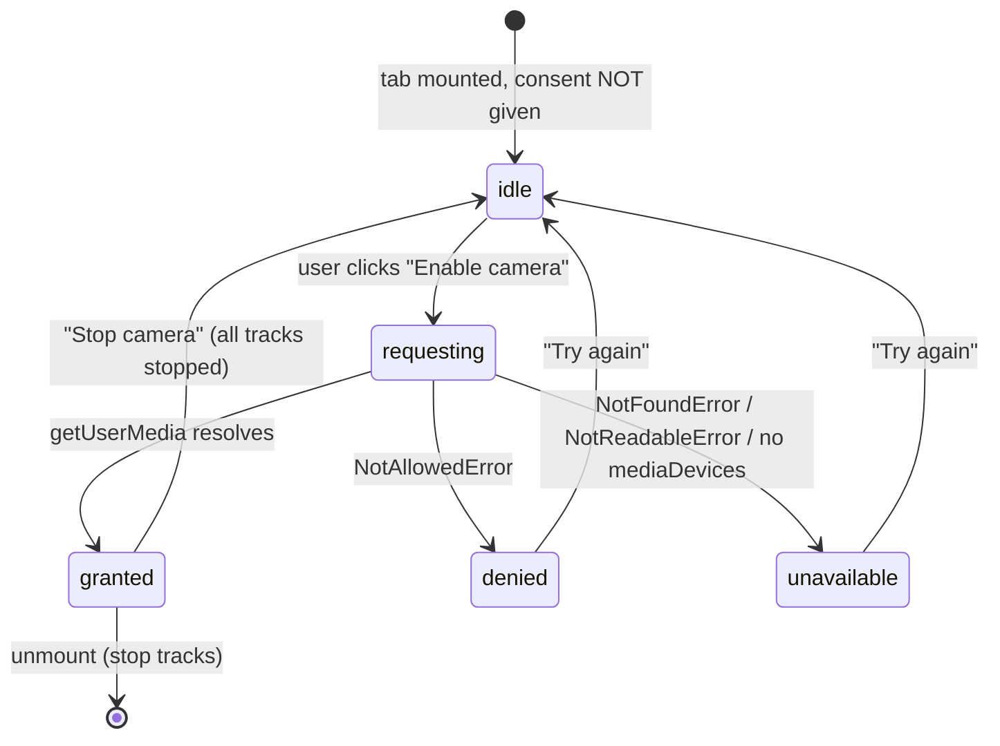

# VibeFit — Sprint 2 Implementation Plan

**Sprint:** VIBE Sprint 2 · 18 Nov – 24 Nov 2026
**Charter milestone:** 11/24/2026 — *Sprint 2: outfit detail, pricing, shopping links, outfit preview and AR virtual try-on*
**Build target:** MSIS-609 working prototype, final demo 12/08/2026
**Plan status:** approved and **implemented** 11/18/2026 — all 21 Sprint 2 criteria verified, 240/240 tests green, typecheck and production build clean. Evidence: [`docs/sprint-2-acceptance-matrix.md`](../docs/sprint-2-acceptance-matrix.md)
**Baseline:** Sprint 1 complete (20/20 ACs, 115 tests) + LumiaRouter Opus 5.5 integration (`4da3ad1`)
**Stack:** Vite + React + TypeScript + Tailwind · React Router · Zustand · Framer Motion · Lucide React
**Visual direction:** Editorial Obsidian & Champagne — unchanged (`#09090B` canvas, `#E5C158` champagne, glassmorphic cards, Framer Motion, `JetBrains Mono` for prices and metrics)

---

## 1. Sprint 2 board

| Jira Key | Story | Epic | Points | Sprint 2 deliverable |
|---|---|---|---|---|
| VIBE-6 | View Outfit Details | AI Outfit Recommendations | 5 | `/results/:outfitId` route |
| VIBE-7 | View Product Prices | AI Outfit Recommendations | 3 | Itemised USD + total vs budget |
| VIBE-8b | Open Shopping Links | AI Outfit Recommendations | 2 | `Shop at [Retailer]` buttons |
| VIBE-10 | Preview Selected Outfit | Virtual Try-On | 5 | `/results/:outfitId/preview` dual-mode |
| VIBE-10-AR | AR Camera Try-On | Virtual Try-On (Charter) | 8 | Consent gate + live overlay |

**Committed:** 5 items / **23 story points**.

**Sprint 1 carry-over risk is closed.** Sprint 1 shipped with its own acceptance matrix (20/20) and the live
Opus 5.5 integration already merged. Sprint 2 is therefore **purely additive**: no Sprint 1 behaviour is
re-specified, only extended. The one exception is a deliberate correctness fix described in §4/D9.

---

## 2. Acceptance-criteria traceability

Every criterion below is demonstrable and covered by an automated test in
[`docs/sprint-2-acceptance-matrix.md`](../docs/sprint-2-acceptance-matrix.md).

### VIBE-6 · View Outfit Details

| AC | Requirement | Implementation home | Verification |
|---|---|---|---|
| **6.1** | Every outfit card on `/results` opens `/results/:outfitId` | [`OutfitCard.tsx`](../app/src/features/results/OutfitCard.tsx) overlay button → `ResultsPage.handleOpenOutfit` → `navigate()` | `outfitDetail.test.tsx` → *opens the detail route from a result card* |
| **6.2** | Detail shows header, Opus 5.5 / engine styling rationale, budget-fit breakdown | [`OutfitDetailPage.tsx`](../app/src/features/outfit/OutfitDetailPage.tsx), `RationalePanel`, [`BudgetMeter`](../app/src/components/ui/BudgetMeter.tsx) | `outfitDetail.test.tsx` → *renders header, rationale and budget breakdown* |
| **6.3** | Itemised grid of every garment piece, with `"Prototype Visual"` badge on placeholder imagery | `OutfitItemCard`, [`PrototypeVisual.tsx`](../app/src/components/ui/PrototypeVisual.tsx) | `outfitDetail.test.tsx` → *lists every piece with a Prototype Visual badge* |
| **6.4** | `"Back to Recommendations"` returns to `/results` with preferences **and** cached results intact | `OutfitDetailPage` back action; results live in the persisted store, never re-generated on mount | `outfitDetail.test.tsx` → *back navigation preserves preferences and the cached result set* (asserts `lastGeneratedAt` is **unchanged**) |

### VIBE-7 · Itemised USD Pricing

| AC | Requirement | Implementation home | Verification |
|---|---|---|---|
| **7.1** | Each item price rendered as `$XX.XX` in `JetBrains Mono` | [`pricing.ts`](../app/src/lib/pricing.ts) `formatItemPrice` + `font-data` class | `pricing.test.ts`; `outfitDetail.test.tsx` asserts `$19.90` text nodes |
| **7.2** | If all prices are numeric → Total Outfit Price compared to budget | `summarisePricing` → `BudgetMeter` + total block | `pricing.test.ts` (complete case); `outfitDetail.test.tsx` → *shows a complete total and its budget verdict* |
| **7.3** | If any `price: null` → `"Price Unavailable"`, total flagged partial, price never invented | `summarisePricing` returns `kind: 'partial'`; UI renders *Partial total* + *Known subtotal* | `pricing.test.ts` → *never substitutes a number*; `outfitDetail.test.tsx` → *flags a partial total for the seeded null-price item* |
| **7.4** | Visible `"Sample Price • Retrieved [Date]"` indicator | `samplePriceLabel` in `pricing.ts` | `pricing.test.ts` (3 date cases); `outfitDetail.test.tsx` asserts the visible string |

### VIBE-8b · Retailer Shopping Links

| AC | Requirement | Implementation home | Verification |
|---|---|---|---|
| **8b.1** | Valid `productUrl` → `"Shop at [Retailer]"`, new tab, `rel="noopener noreferrer"` | `OutfitItemCard` `<a>` | `outfitDetail.test.tsx` → *renders a safe external link per item* |
| **8b.2** | `productUrl: null` → no clickable link, subtle `"Link Unavailable"` label | `OutfitItemCard` branch | `outfitDetail.test.tsx` → *suppresses the link for the seeded null-URL item* (asserts zero anchors in that card) |

### VIBE-10 · Dual-Mode Preview & AR Try-On

| AC | Requirement | Implementation home | Verification |
|---|---|---|---|
| **10.1** | Prominent `"Preview & AR Try-On"` button on detail; close/back returns to detail | `OutfitDetailPage` CTA → `/results/:outfitId/preview`; `PreviewPage` back action | `preview.test.tsx` → *opens preview and returns to detail* |
| **10.2** | Tab 1 — all pieces assembled in one layout, labelled `"Illustrative Prototype Preview"` | [`CombinedLook.tsx`](../app/src/features/preview/CombinedLook.tsx) | `preview.test.tsx` → *assembles every piece under the prototype label* |
| **10.3** | Tab 2 — live `getUserMedia` overlay for the **5 `arSupported` tops/jackets**, switchable | [`ArTryOnTab.tsx`](../app/src/features/preview/ArTryOnTab.tsx), [`arGarments.ts`](../app/src/features/preview/arGarments.ts), [`useCameraStream.ts`](../app/src/features/preview/useCameraStream.ts) | `preview.test.tsx` → *offers all five AR garments and switches overlay* |
| **10.4** | **Privacy consent gate** before `getUserMedia`: explicit card, video stays local, zero upload/retention | [`ConsentCard.tsx`](../app/src/features/preview/ConsentCard.tsx) | `preview.test.tsx` → *does not request the camera before consent*; *requests exactly once after consent* |
| **10.5** | Denial / unavailable device handled gracefully with interactive silhouette fallback | `useCameraStream` status machine → `SilhouetteStage` | `preview.test.tsx` → 3 tests (`NotAllowedError`, no `mediaDevices`, `NotFoundError`) all land on the silhouette and keep controls live |
| **10.6** | Scale, horizontal/vertical offset, opacity controls | [`AlignmentControls.tsx`](../app/src/features/preview/AlignmentControls.tsx) | `preview.test.tsx` → *applies scale, offset and opacity to the overlay* |
| **10.7** | Disclaimer: *"Visual appearance preview only — does not guarantee exact sizing or fit."* | `PreviewPage` footer, rendered in **both** tabs | `preview.test.tsx` → asserts the string in both tabs |

### Charter — AR virtual try-on scope

| Charter requirement | Implementation | Verification |
|---|---|---|
| Exactly 5 supported tops/jackets | `arSupported: true` set in [`catalog.json`](../app/src/data/catalog.json); `AR_GARMENTS` derived, never hardcoded | `arGarments.test.ts` → *exactly five garments, all top/layer, all with an overlay asset* |
| Camera use is opt-in and explained | Consent card precedes any device API call | `preview.test.tsx` consent suite |
| No image leaves the browser | Overlay is composited in the DOM; no fetch, no canvas export, no upload path exists in the code | `preview.test.tsx` → `fetch` spy is never called in the AR flow |
| Honest about fidelity | Persistent prototype badges + sizing disclaimer | `preview.test.tsx` |

---

## 3. Scope guard

**In Sprint 2**

- Outfit detail route with header, rationale, budget breakdown, itemised garment grid
- USD item pricing, complete vs partial totals, sample-price provenance badges
- Retailer outbound links with correct `rel`, and suppression for the null-URL edge case
- Dual-mode preview: combined-look composition and camera AR try-on with consent gating
- Five hand-authored SVG garment overlays served from `app/public/ar/`
- Alignment controls shared between camera and silhouette modes
- Vitest coverage for all Sprint 2 ACs, plus the acceptance matrix doc
- Verbose-only additive changes to Sprint 1 files (one routing line, one click handler, badge copy)

**Explicitly out of Sprint 2**

- True 3D garment warp / pose estimation / body measurement (needs ML inference the prototype does not host)
- Server-side rendering of try-on frames, any upload of camera frames, any image retention
- Checkout, affiliate tracking, price re-scraping, auth
- Changing the recommendation engine's scoring or filters
- Changing the Sprint 1 design system's palette, typography or motion vocabulary

**Scope tension to be aware of.** Real virtual try-on requires pose estimation over a live video stream. The
charter asks for a *prototype* try-on, so this sprint delivers a **2D overlay compositor**: a transparent
garment PNG/SVG positioned over the video with user-driven alignment. That is genuinely useful for
"does this silhouette suit me", and it is honest — the disclaimer, the prototype badges and the "align it
yourself" controls together prevent the sponsor from reading it as fit-accurate sizing. The overlay maths is
isolated in `AlignmentControls` → a single `OverlayTransform` value, which is exactly the seam a pose model
would later write into.

---

## 4. Decisions

| # | Decision | Resolution | Consequence |
|---|---|---|---|
| D7 | Preview as a route or a modal? | **Route** `/results/:outfitId/preview` | Deep-linkable, back-button-correct, and testable with `MemoryRouter` without portal hacks. A modal would need focus-trap work for equal accessibility at more cost. |
| D8 | Where do garment overlays come from? | **Hand-authored SVGs in `app/public/ar/`**, `overlayAsset` re-pointed from `.png` to `.svg` | Sprint 1 reserved the *paths*; Sprint 2 supplies real assets. No binary blobs, no broken ``, and the assets are diff-reviewable. |
| D9 | How does "Back to Recommendations" keep cached results? | **Fix the results mount effect** so it re-generates only on an actual preference *change* | Today `ResultsPage`'s effect fires on mount too, so every return from detail re-ran `generate()` — deterministically identical, but it cleared `aiReasons`/`aiOrder` and re-billed a live Opus call. A `useRef` signature guard makes AC 6.4 literally true instead of coincidentally true. |
| D10 | Detail page when the outfit is not in the cached result set (deep link, cleared store)? | **Recompute from the catalog** via `rankedOutfitById()`, falling back to the store copy when present | No dead route; the same rule as the Sprint 1 results guard. Genuinely unknown ids get an explicit not-found card, not a blank page. |
| D11 | Preserve live Opus rationale on the detail screen? | **Yes**, with an explicit provenance badge: `Opus 5.5 Live` vs `Local Engine` | The story asks for the Opus 5.5 rationale. `aiReasons` is intentionally *not* persisted (it is derived from one specific result set), so the detail page must state which source it is showing rather than implying the model wrote the engine's chips. |
| D12 | Consent state persistence | **In-memory only, per mount, defaulting to `false`** | A stored "yes" would silently re-open the camera on a later visit. Consent must be re-obtained per session. |
| D13 | Camera fallback trigger | **`NotAllowedError`, `NotFoundError`, `NotReadableError`, missing `mediaDevices`, and any other rejection** all resolve to a rendered silhouette stage | One code path, three named reasons, each with its own honest message. A device that half-works must not dead-end the tab. |
| D14 | Where does pricing maths live? | **`src/lib/pricing.ts`**, pure, mirrors `src/lib/format.ts` | The `null`-price rule is the single most testable correctness requirement in this sprint; it must not live inside JSX. |

---

## 5. Architecture



**Data resolution on the detail route** — one function, two sources, never a blank screen:

```ts
// src/engine/lookup.ts
function rankedOutfitById(outfitId, prefs, catalog): RankedOutfit | null
//  1. find the outfit in the catalog           → null if genuinely unknown
//  2. resolve itemIds → Product[]              → null if any id is dangling
//  3. outfitPricing(items)                     → knownTotal, priceComplete
//  4. scoreOutfit(...) + outfitHasArSupport()  → same shape the results grid renders
```

The page prefers the store copy when present (it carries the live Opus rationale context), and falls back to
this function otherwise. Both produce the same type, so every child component takes `RankedOutfit` and does
not care which path it came from.

**AR state machine** (`useCameraStream`) — the camera is a side effect that must be impossible to trigger
accidentally, and impossible to leave on:



Two separate booleans, deliberately: `consentGiven` (a user intention) and `status` (a device outcome). Merging
them into one enum is what produces the bug where "denied" is remembered as "do not ask again" and the user
can never retry.

---

## 6. Component and file map

### New

| File | Purpose |
|---|---|
| `app/src/lib/pricing.ts` | Pure price display + outfit pricing summary + sample-price label |
| `app/src/engine/lookup.ts` | `rankedOutfitById()` deep-link fallback resolver |
| `app/src/components/ui/PrototypeVisual.tsx` | Deterministic placeholder tile + `Prototype Visual` badge |
| `app/src/features/outfit/OutfitDetailPage.tsx` | Story 6 route container |
| `app/src/features/outfit/OutfitItemCard.tsx` | One garment: visual, name, retailer, price, shop link |
| `app/src/features/outfit/RationalePanel.tsx` | Opus 5.5 / engine rationale + provenance badge |
| `app/src/features/preview/PreviewPage.tsx` | Story 10 route container + tabs + disclaimer |
| `app/src/features/preview/CombinedLook.tsx` | Tab 1 composition |
| `app/src/features/preview/ArTryOnTab.tsx` | Tab 2 orchestration |
| `app/src/features/preview/ConsentCard.tsx` | Charter privacy gate |
| `app/src/features/preview/AlignmentControls.tsx` | Scale / offset / opacity controls |
| `app/src/features/preview/GarmentSwitcher.tsx` | The five AR garments, `aria-pressed` |
| `app/src/features/preview/useCameraStream.ts` | Camera lifecycle hook |
| `app/src/features/preview/arGarments.ts` | Derives AR garments from the catalog; default selection |
| `app/public/ar/*.svg` | Five garment overlay assets |

### Modified (small, additive)

| File | Change |
|---|---|
| `app/src/App.tsx` | Two new routes |
| `app/src/features/results/ResultsPage.tsx` | Real click handler (D9 signature guard also lands here) |
| `app/src/features/results/OutfitCard.tsx` | Badge copy `AR Ready` → `AR Try-On`; aria-label gains "details" |
| `app/src/components/layout/Header.tsx` | `Sprint 1 Prototype` → `Sprint 2 Prototype` |
| `app/src/data/catalog.json` | `overlayAsset` `.png` → `.svg` for the five AR garments |
| `app/src/test/setup.ts` | Deterministic `mediaDevices` absent-by-default documentation comment |

### New tests

| File | Covers |
|---|---|
| `app/src/lib/__tests__/pricing.test.ts` | 7.1–7.4 pure logic incl. `null` handling |
| `app/src/engine/__tests__/lookup.test.ts` | D10 fallback resolution |
| `app/src/features/outfit/__tests__/outfitDetail.test.tsx` | 6.1–6.4, 7.1–7.4, 8b.1–8b.2 |
| `app/src/features/preview/__tests__/preview.test.tsx` | 10.1–10.7, charter AR scope |
| `app/src/features/preview/__tests__/arGarments.test.ts` | Five-garment invariant |
| `app/src/features/__tests__/flow.test.tsx` | One added round-trip test: results → detail → back |

---

## 7. Pricing rules (the exact contract)

`summarisePricing(items)` returns a discriminated union so the UI cannot render a partial total by accident:

```ts
type PricingSummary =
  | { kind: 'complete'; knownTotal: number; unknownPriceCount: 0; ... }
  | { kind: 'partial';  knownTotal: number; unknownPriceCount: number; missing: Product[]; ... };
```

| Situation | Item row | Total row |
|---|---|---|
| `price: 19.9` | `$19.90` in `JetBrains Mono` + `Sample Price • Retrieved 2026-11-18` | included in the total |
| `price: null` (seeded: `p-linen-trouser`) | `Price Unavailable` — no dollar sign anywhere in that row | total is labelled **Partial total**, the `$` figure is labelled **Known subtotal**, and a line reads *"1 item has no listed price — the total is a lower bound."* |
| every price known | — | **Total Outfit Price** `$XXX.XX`, then the budget verdict via `BudgetMeter` |
| `budget` is null | — | total shown without a verdict line |
| `priceRetrievedAt: null` | `Sample Price • Retrieval date unavailable` | — |

Hard rules: no `0`, no estimated, no range midpoint, no "~", no "from $0". A `null` price is excluded from
the sum and reported as unknown. `Math.round(x*100)/100` before formatting so cents never drift.

---

## 8. AR try-on design

**Frame.** `position: relative` stage with an `aspect-[3/4]` frame. Camera `<video>` (or silhouette `<svg>`)
fills it; the garment `` is absolutely positioned with:

```
transform: translate(${offsetX}%, ${offsetY}%) scale(${scale / 100})
opacity: opacity / 100
transform-origin: 50% 40%   /* collar-ish anchor: rotating/scaling from the chest reads naturally */
```

**Consent card** (before *any* device call) states, in plain language:
1. What is requested: "VibeFit asks your browser for permission to use your webcam."
2. Why: "so you can see a garment overlay on your own image."
3. What happens to the video: "The video is processed entirely in this browser tab. Nothing is recorded,
   stored, uploaded, or sent to a server — including our own."
4. The choice: primary `Enable camera`, secondary `Use silhouette mode instead`.

The "video stays local" claim is not a promise, it is an architectural fact: there is no `fetch`, no
`FormData`, no canvas export and no `MediaRecorder` anywhere in the preview feature. The test asserts a `fetch`
spy is never called across the whole AR flow.

**Silhouette fallback** keeps the tab fully useful: a neutral human outline, the same garment overlay, the
same four controls. Everything except the camera feed still works, so a denied permission in the lecture hall
demonstrates the feature rather than an error.

**Garment switcher.** The five `arSupported` products, each rendered as a chip carrying its name and slot and
an `In this outfit` marker where applicable. Selecting one swaps `overlayAsset` only — the transform values are
preserved, because re-aligning on every switch is the fastest way to make a demo look broken.

**Controls.** Four labelled range inputs (`Scale`, `Horizontal`, `Vertical`, `Opacity`) with live mono readouts
and a `Reset alignment` button. Each has an `aria-label`, a `<label for>`, and a visible numeric value so the
control is usable without dragging precisely.

---

## 9. Design system additions (no palette changes)

| Element | Treatment |
|---|---|
| Detail header | Outfit name in Instrument Serif, tagline below, `MatchRing` at 64px, mono meta row (`occasion · dress code · pieces`) |
| Item card | Glass tile, `aspect-[3/4]` prototype visual, slot label as a mono eyebrow, price in `JetBrains Mono` at `text-base`, shop link as a champagne-outlined pill |
| `Prototype Visual` badge | Champagne hairline border, `bg-obsidian/70`, mono uppercase `0.5625rem` — readable over any placeholder gradient |
| Sample price badge | Violet-tinted, matching the AI provenance language already used by the chat dock |
| Partial-total notice | Amber (`fit-tight`) text, never rose: an unknown price is uncertainty, not an error |
| Tabs | Underline indicator with Framer `layoutId`, `aria-selected`, arrow-key navigation |
| Preview stage | Full-bleed glass panel with `edge-highlight`; controls in a stacked panel beneath |
| Motion | Reuses `pageTransition` / `cardReveal` / `staggerContainer` from `lib/motion.ts`; overlay transform updates are **not** animated (direct manipulation must feel 1:1) |

No new hex values. No new animation vocabulary. `prefers-reduced-motion` and Vitest collapse behaviour is
inherited from the existing `useMotion()` hook.

---

## 10. Test plan

Target: **~40 new tests** on top of the existing 115.

| Suite | # | Focus |
|---|---|---|
| `pricing.test.ts` | 11 | `$XX.XX` formatting; complete total; `null` exclusion; partial summary shape; no invented number; sample-price label with date; null-date fallback; budget verdict boundaries; cents rounding |
| `lookup.test.ts` | 5 | Known outfit resolves; unknown id → `null`; AR readiness; totals match the engine's; dangling item id rejected |
| `outfitDetail.test.tsx` | 13 | 6.1 click-through; 6.2 header/rationale/breakdown; 6.3 all pieces + prototype badge; 6.4 back preserves prefs **and** `lastGeneratedAt`; 7.1 all six seeded prices render in mono; 7.3 partial total for `p-linen-trouser`; 7.4 sample-price text; 8b.1 `target`/`rel`; 8b.2 no anchor for `p-hoops`; not-found state; deep link with empty store; AR CTA visible only when `arReady` |
| `preview.test.tsx` | 14 | 10.1 open + close; 10.2 combined look labelled; 10.3 five garments + switching; 10.4 no `getUserMedia` before consent / exactly once after; consent copy mentions local-only; 10.5 three error paths → silhouette + controls live; 10.6 transform values applied; 10.7 disclaimer in both tabs; no `fetch` in AR flow; stop-camera releases tracks; timer/track cleanup on unmount |
| `arGarments.test.ts` | 3 | Exactly five; all `top`/`layer`; all have overlay assets |
| `flow.test.tsx` | 1 | results → detail → back round trip |

**Testing mechanics.** `navigator.mediaDevices.getUserMedia` is undefined in jsdom by default, which is itself
the "unsupported device" case. Tests install a stub via
`Object.defineProperty(navigator, 'mediaDevices', { configurable: true, value: {...} })` and delete it in
`afterEach`, so no test can leak a granted camera into the next. Track fixtures expose `stop()` as a `vi.fn()`
so the release assertion is real. No `sleep`, no animation assertions — motion collapses synchronously under
`MOTION_DISABLED`.

---

## 11. Risks

| Risk | Impact | Mitigation |
|---|---|---|
| Camera unavailable in the demo room or on the presenter's machine | Headline AR feature "does not work" on stage | Silhouette fallback is a first-class mode with a one-click entry, not an error screen. Dry-run the demo on the presentation machine during §12. |
| `getUserMedia` requires a secure context | Feature dead on a plain-HTTP LAN host | Dev is `localhost` (a secure context); document "serve over HTTPS or localhost" in the demo script. |
| Reviewers read the overlay as fit-accurate sizing | Overclaims vs the charter | Persistent disclaimer in both tabs, `Prototype Visual` badges, and the alignment controls make the manual nature obvious. |
| `null`-price handling regresses into `0` | Invents a total, the exact failure the charter forbids | `PricingSummary` is a discriminated union — a partial summary cannot be rendered as a total without a type error. Ten tests guard it. |
| Detail route re-generates and wipes AI reasons | AC 6.4 fails subtly, costs a live API call per navigation | D9 ref-based signature guard, asserted by `lastGeneratedAt` equality. |
| New routes break the Sprint 1 route guard | Blank detail page on refresh | Detail/preview both redirect to `/preferences` without required inputs, and resolve from the catalog independently of the cached result set. |
| SVG overlays look crude next to real photography | Visual credibility in the demo | Overlays are intentionally illustrative (flat, champagne-outlined), matching how the whole prototype already signals "curated sample data". Nothing pretends to be product photography. |
| Sprint capacity: 23 points including AR | Slips past 11/24 | Stories 6/7/8 land first and are independently demoable. 10.2 (combined look) precedes 10.3–10.6 so a camera-blocked finish still ships a complete preview. |

---

## 12. Definition of Done

1. All Sprint 2 acceptance criteria (6.1–6.4, 7.1–7.4, 8b.1–8b.2, 10.1–10.7) have a passing test mapped in
   [`docs/sprint-2-acceptance-matrix.md`](../docs/sprint-2-acceptance-matrix.md).
2. `npm run typecheck && npm test && npm run build` pass clean, with the Sprint 1 suite still green.
3. Every card on `/results` navigates to its detail route; back returns with preferences and the cached
   result set byte-identical (`lastGeneratedAt` unchanged).
4. No `price: null` item ever produces a dollar figure, and every partial total is labelled partial.
5. The seeded `productUrl: null` item renders no anchor element at all.
6. The AR tab never calls `getUserMedia` before consent, never fetches, and never retains a track after
   unmount or "Stop camera".
7. Denied, unavailable and unsupported camera paths all land on a working silhouette mode.
8. The sizing disclaimer is visible in both preview tabs.
9. Design system unchanged: zero hardcoded hexes in the new feature components; all motion from
   `lib/motion.ts`; all prices in `JetBrains Mono`.
10. Demo script updated for the 11/24 milestone and the new three-step journey.
